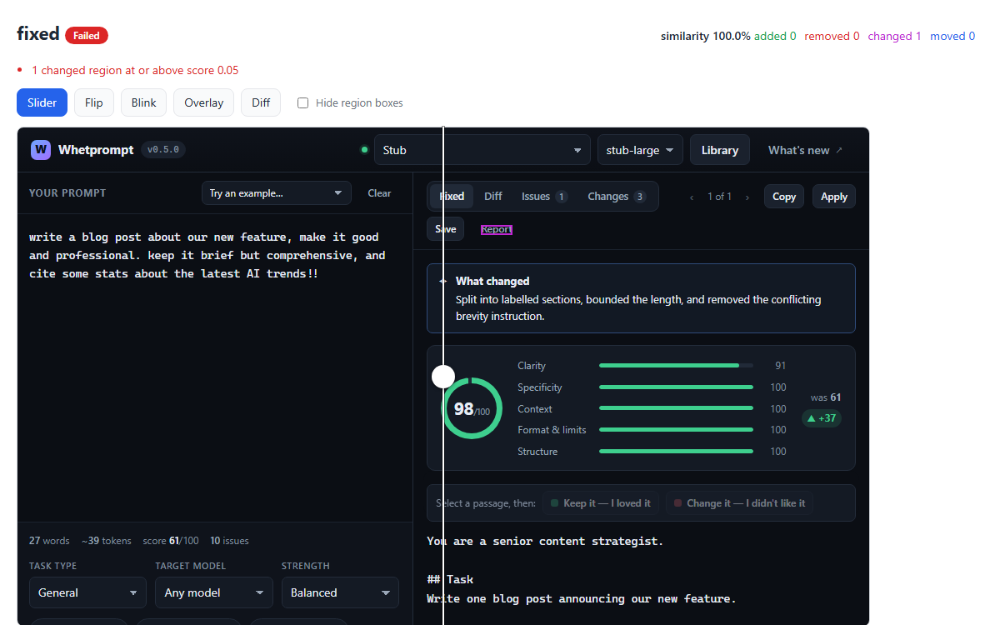

# Elastishot in real projects

These projects, by Elastishot's author, use it on every change. Each one shows a different way of getting the two sides of a comparison into the same state before the capture. The pictures are real reports from the runs described here, not mock-ups.

- [A static site with tabs](#a-static-site-with-tabs-osmanturalioglucom): `elastishot pr` and the GitHub Action on every pull request.
- [An app whose screens only exist after a few steps](#an-app-whose-screens-only-exist-after-a-few-steps-whetprompt): each target drives the real interface, against the real server and a stub model.
- [A phone app's web build](#a-phone-apps-web-build-an-unreleased-meal-app): the clock, the locale, the timezone and the stored state pinned, so one build always gives the same picture.
- [What they have in common](#what-they-have-in-common)

## A static site with tabs: osmanturalioglu.com

[Osman19702/my-portfolio](https://github.com/Osman19702/my-portfolio) is a one-page site whose sections are tabs. Only the active section is laid out, so every section is a target of its own, opened by clicking its tab before the capture. Five sections, two colour schemes and two widths make 20 pairs.

```js
const SECTIONS = ['home', 'about', 'certifications', 'projects', 'contact']
const THEMES = ['dark', 'light']

const openTab = (id) => async (page) => {
  if (id !== 'home') await (await page.$(`.control[data-id="${id}"]`)).click()
  await page.waitForSelector(`#${id}.active`)
  await page.waitForTimeout(300)
}

export default {
  viewports: [{ name: 'desktop', width: 1440, height: 900 }, { name: 'mobile', width: 360, height: 780 }],
  capture: { fullPage: true, waitUntil: 'load' },
  targets: SECTIONS.flatMap((id) =>
    THEMES.map((theme) => ({ name: `${id}-${theme}`, url: '/', capture: { colorScheme: theme, waitFor: openTab(id) } })),
  ),
}
```

The site has no build, so there is no `pr` block: each side's folder is served as it is. `npm run visual` is `elastishot pr`, and the pull request job is `actions/checkout` with `fetch-depth: 2`, `npm ci` and `uses: Osman19702/elastishot-action@v0.3`.

**A real run.** [Pull request #18](https://github.com/Osman19702/my-portfolio/pull/18) updated the site's Elastishot card for 0.3.0. The check passed the 16 pairs it did not touch and flagged the 4 Projects pairs, both themes at both widths. On the card it outlined the new release note, the test counts, the package size and digest, and a subsection that was inserted. The job stayed green with a notice, and its summary has the table. The picture is the same check run locally:

![An Elastishot pair report for projects-dark at desktop width, with the slider at actual size. Left of the slider, the page before: the bullet "New in 0.2.0: a card whose picture is redrawn…" is selected, and the old test counts 30 and 224 are outlined. Right of the slider, the page after: the new subsection "Check pull requests with the GitHub Action" is outlined in green as added. The chip at the bottom names the selected region, role=listitem[name="New in 0.2.0: …"].](examples/portfolio-pr18.png)

A section without test ids is named by its role and accessible name where it has one, as the bullet is, and otherwise by a CSS path such as `#projects > div:nth-of-type(2) > article:nth-of-type(2) > …`. The next project shows what test ids buy.

## An app whose screens only exist after a few steps: Whetprompt

[Osman19702/Whetprompt](https://github.com/Osman19702/Whetprompt) is a desktop app (Electron and React) that lints, scores and rewrites prompts with a local model. Most of its screens exist only after the user has done something: typed a prompt, run a fix, marked passages, opened a tab or the library. So each target is a list of steps that the capture performs against the real server. A scripted stub stands in for the model, so every run shows the same picture with no model download and no API key.

```js
// One screen: an empty library, the loaded app, the steps in order, then nothing of the driver left on the picture.
const screen = (name, ...steps) => ({
  name,
  url: `${BASE}/`,
  capture: {
    waitFor: async (page) => {
      await emptyLibrary(page)
      await ready(page)
      for (const step of steps) await step(page)
      await atRest(page) // mouse parked, nothing focused or selected, panes scrolled to the top, no spinner
    },
  },
})

export default {
  viewports: [{ name: 'desktop', width: 1360, height: 880 }, { name: 'small', width: 1024, height: 720 }],
  capture: {
    hide: ['[data-testid="toasts"]', '[data-testid="library-entry-date"]'], // they carry elapsed seconds and today's date
    mask: ['[data-testid="run-details"]'], // timings and token counts
  },
  targets: [
    screen('empty'),
    screen('issues', typeSample),
    screen('fixed', typeSample, fix),
    screen('marked', typeSample, fix, markBoth),
    screen('diff', typeSample, fix, openTab('Diff')),
    screen('changes', typeSample, fix, openTab('Changes')),
    screen('library', typeSample, fix, saveAndOpenLibrary),
  ],
}
```

Its own runner, `npm run visual -- --against <ref>`, does what `elastishot pr` does: it checks the ref out, builds it, serves it with its own server and stub, and compares the working tree with it. CI runs it on every push, against the commit the push landed on (for a pull request, against its target branch). A difference never fails that job; only a comparison that could not be made does.

**A real run: 0.5.0 against 0.6.0.** Whetprompt 0.6.0 added a Report button beside every rewrite: the Microsoft Store asks that output from generative AI can be reported. Compared screen by screen, 7 screens at 2 window sizes:
- `empty` and `issues` passed: they come before a rewrite, so they have no button.
- The four screens with a rewrite (`fixed`, `marked`, `diff`, `changes`) were flagged. At the small size the new element is the one named: `FAIL fixed [small] -> [data-testid="report-link"]`. At the desktop size the buttons it pushed along are named too: Apply, Copy and Save.
- `library` was flagged for one digit. A saved prompt records the version that saved it, and "Saved by Whetprompt 0.5.0" now says 0.6.0: a 6 × 9 pixel region, named `[data-testid="library-entry-version"]`.



![An Elastishot pair report for the Whetprompt library screen, with the slider at actual size: the library drawer lists one saved prompt, and one digit of its version label is outlined. The chip at the bottom reads: changed r1, Saved by Whetprompt 0.5.0, [data-testid="library-entry-version"], score 0.38.](examples/whetprompt-one-digit.png)

## A phone app's web build: an unreleased meal app

This one is an Expo app (iOS, Android and the web) that suggests meals, for the UK and Turkey, in English and Turkish. It is not released yet and its repository is private, so it appears here without its name. The visual check captures the web build (`expo export -p web`, served from `dist/`): the plate and the recipe, cook mode, the fridge, the kitchen and onboarding, in both colour schemes, in Turkish and with large text. It runs on the developer's machine against baselines approved on that machine, and a pull request that changes the picture quotes the run it approved.

What it takes to get the same picture twice:
- **No date and no state of its own.** The app greets by the time of day, remembers what is at home and sends a first visit to onboarding. Its capture adapter pins the clock, the locale and the timezone, and seeds the stored state that `?fixture=` on the target URL names. Since 0.3.0 that is configuration: `capture.clock`, `capture.locale`, `capture.timezoneId`, and `capture.storageState` or `capture.setup`.
- **Waits by role, so one config serves both languages.** `page.getByRole('button', { name: /^(Main|Ana yemek): / })` finds the plate in English and in Turkish.
- **A viewport as tall as the screen.** The content scrolls in an inner element, so `fullPage` has nothing to extend; each target names a viewport tall enough for all of it (`phone` 1100 px, `phone-tall` 2800 px, `phone-xtall` 3700 px).
- **Photos finished.** Every dish photo on screen has loaded, faded in and been decoded before the capture.

**A real run: one pull request, four changes.** One pull request made the web build accessible (WCAG 2.2 AA), dropped Simple mode, ranked the ideas on the Fridge tab by what is at home, and folded the kitchen by cuisine. Both builds were captured in one session, the pull request's against the commit before it:
- 37 of 49 pairs passed. The accessibility work changed titles, tab stops, ARIA and live regions, not pixels, and nothing flagged it.
- The Me screen, in both colour schemes and in Turkish, lost one row, `[data-testid="me-simple-mode"]`. The settings below it moved up and were compared in their new place, so the removal is one region, not the rest of the screen. The only other region is the 70 pixels of empty page that the shorter list left at the bottom, tagged `whitespace-only`.
- All six kitchen pairs changed one 16 × 9 pixel region beside the cuisine heading: the new fold chevron. Before, that place belonged to the heading, `role=heading[name="Turkish"]` (`"Türk"` in Turkish); after, to the new fold button, `[data-testid="kitchen-cuisine-turkish-button"] > div:nth-of-type(2)`. The pair with a dish open over the kitchen also flagged the button itself and three small regions in two dish rows.
- The ideas were re-ranked: dishes such as `[data-testid="ideas-dish-m-edamame"]` left the list and `[data-testid="ideas-dish-p-karides-guvec"]` joined it.

![An Elastishot pair report for the app's Me screen on a phone, with the slider at actual size. Under Settings, left of the slider, the row "Simple mode: Bigger plate and fewer buttons" is outlined in red as removed; right of the slider the same place is a tinted gap. The chip at the bottom reads: removed r1, the row's text, [data-testid="me-simple-mode"] > div:nth-of-type(1), score 0.57.](examples/meal-app-simple-mode.png)

## What they have in common

- **Both sides come from one machine.** The site and the desktop app compare with a commit, built and served next to the working tree; the phone app compares with baselines approved on the same machine. No project compares with pictures from another machine, so fonts and the browser build cannot differ.
- **Get to the screen in `waitFor`, then leave nothing of the driver behind.** Park the mouse, blur the focus, clear any selection and wait for spinners and images to settle.
- **Keep out what differs between two honest captures.** `hide` what comes and goes, such as toasts. `mask` what changes in place, such as timings. Pin the clock, the locale and the timezone (`capture.clock`, `capture.locale`, `capture.timezoneId`) when the screen shows today's date.
- **Test ids buy readable names.** `[data-testid="report-link"]` says what changed; a CSS path says where.
